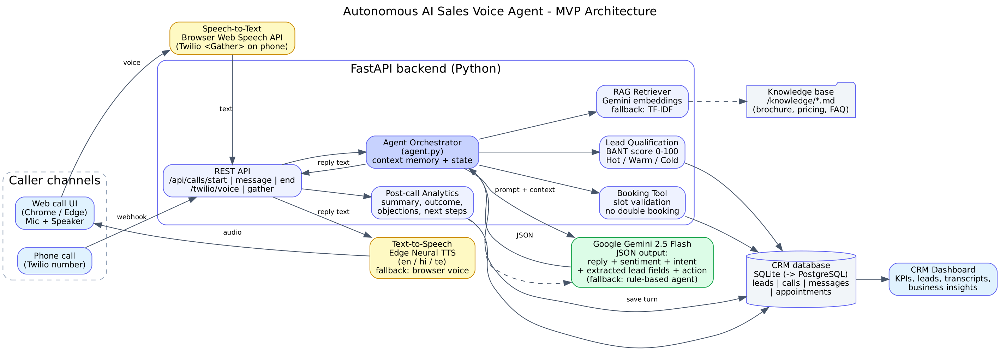

# 🎧 Autonomous AI Sales Voice Agent

A working prototype of an AI voice agent that **talks to sales leads, answers from a knowledge base, qualifies them, books site visits, writes to a CRM, and summarises every call** in English, Hindi and Telugu.

Demo business: **GreenNest Residences**, a fictional real-estate project in Whitefield, Bengaluru. The agent "Priya" handles inbound enquiries.



## End-to-end business workflow (demonstrated live)

```
Lead calls → Agent greets (recognises returning callers)
          → Answers questions using RAG over brochure / pricing / FAQ
          → Qualifies the lead (need, budget, timeline, decision maker, contact) → live score 0-100
          → Detects sentiment + intent on every turn, handles objections
          → Offers & books a site visit (validated slots, no double-booking)
          → Call ends → AI summary, outcome, objections, next steps → CRM dashboard
```

## Feature status

| Requirement | Status | How |
|---|---|---|
| Real-time voice (STT + TTS) | ✅ Built | Browser Web Speech API (STT), Edge neural TTS with browser-voice fallback, hands-free loop, barge-in |
| Contextual memory | ✅ Built | Full conversation history and lead profile in every prompt. Returning callers are recognised by phone and their past call summaries are loaded. |
| Multilingual | ✅ Built | English, Hindi, Telugu: STT locale, LLM reply language and neural TTS voice |
| Lead qualification | ✅ Built | LLM extracts BANT facts as JSON, then a transparent rule-based score with a points breakdown (Hot/Warm/Cold) |
| Sentiment analysis | ✅ Built | Per-turn LLM sentiment (-1..1), lexicon fallback, lead-level average |
| RAG knowledge retrieval | ✅ Built | Markdown KB → chunks → Gemini multilingual embeddings (cosine), TF-IDF fallback, sources shown in UI |
| Appointment booking | ✅ Built | LLM tool-style action `book_appointment`, server-side slot validation, unique constraint |
| CRM integration | ✅ Built (own CRM) | SQLite CRM (leads, calls, messages, appointments) and dashboard. HubSpot/Zoho sync is described in the architecture doc. |
| Call summary + business insights | ✅ Built | Post-call LLM analysis, dashboard KPIs, conversion %, top objections/interests |
| Phone calls | 🟡 Optional | `/twilio/voice` webhook using Twilio `<Gather>`/`<Say>` (needs a Twilio number + ngrok) |
| Streaming low-latency audio, outbound dialer | 📐 Designed | See `docs/ARCHITECTURE.md` |

**Resilience:** if Gemini is rate-limited or offline, the agent switches automatically to a **rule-based engine** (regex extraction, KB answers, booking flow), so a demo never dies.

## Run it (5 minutes)

```bash
# 1. Python 3.10+
python -m venv venv
venv\Scripts\activate            # Windows   (Mac/Linux: source venv/bin/activate)
pip install -r requirements.txt

# 2. Free Gemini key: https://aistudio.google.com/apikey
copy .env.example .env          # Mac/Linux: cp .env.example .env
#    then paste the key into GEMINI_API_KEY=

# 3. Start
uvicorn app.main:app --reload
```

Open **http://localhost:8000** in **Chrome or Edge**, allow the microphone, and click **Start call**.
The CRM dashboard is at **http://localhost:8000/dashboard**, and the API docs at http://localhost:8000/docs.

Tests: `python -m pytest -q`

## Project structure

```
app/
  main.py        FastAPI routes: call API, TTS, dashboard API, KB reload
  agent.py       ★ Agent brain: start_call / handle_turn / end_call, prompts, rule-based fallback
  llm.py         Gemini wrapper (JSON mode, thinking off for low latency, model fallback)
  rag.py         Knowledge base: chunking, embeddings / TF-IDF, search
  scoring.py     Lead score (BANT) + lexicon sentiment
  booking.py     Slots, validation, booking
  db.py          CRM schema + queries (SQLite, Postgres-ready, tenant_id on every table)
  telephony.py   Twilio phone-call webhooks (optional)
  config.py      Settings from .env
static/          index.html + app.js (voice call UI), dashboard.html + dashboard.js
knowledge/       Markdown knowledge base. Edit it and POST /api/knowledge/reload.
docs/            Architecture diagrams, scalability/security/cost, demo script
tests/           pytest suite
```

## How one turn works (`agent.handle_turn`)

1. **Retrieve**: top-3 KB chunks for the caller's sentence (RAG).
2. **Prompt**: system rules + lead profile + previous call summaries + KB chunks + free slots + conversation.
3. **Gemini returns JSON**: `reply`, `sentiment_score`, `intent`, `lead_updates`, `action`. That is one LLM call per turn, which keeps latency and cost low.
4. **Backend applies it**: saves to the CRM, merges returning callers, validates and books the slot (the LLM never writes to the DB directly), and recomputes the score.
5. **Reply** goes back to the browser, which speaks it and starts listening again.

## Tech stack
Python · FastAPI · Google Gemini 2.5 Flash (free tier) · Gemini embeddings · scikit-learn · SQLite · Edge TTS · Web Speech API · vanilla JS · Docker · Twilio (optional)
