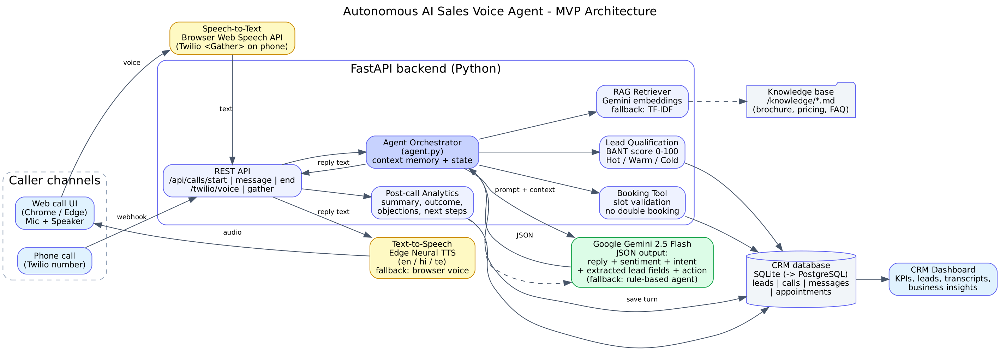
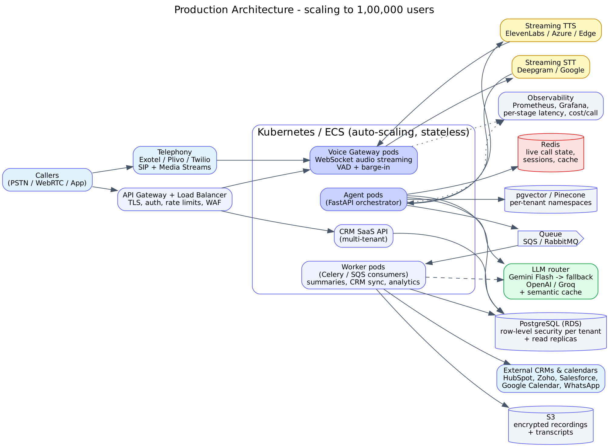

# Architecture, Scalability, Security & Cost

## 1. Business problem
Indian real-estate, ed-tech, insurance and loan businesses get thousands of leads from ads and portals. Most leads are called **late or never**: tele-calling teams are expensive, slow, inconsistent, and work office hours only. Speed-to-lead is critical, because a lead contacted within minutes is far more likely to convert than one called the next day.

**Solution:** an AI sales voice agent that calls or answers every lead instantly, 24×7, in the lead's language. It answers questions accurately from company documents, qualifies the lead, books the appointment and logs everything in the CRM. Human sales staff then spend their time only on **Hot** leads that already have booked visits.

**Who pays:** businesses buy it as a SaaS add-on to the CRM, priced per minute or per qualified lead.

## 2. MVP architecture (what is built)

| Layer | MVP choice | Why |
|---|---|---|
| STT | Browser Web Speech API (`en-IN`, `hi-IN`, `te-IN`) | Free, real-time, no audio upload |
| LLM | Gemini 2.5 Flash, JSON mode, thinking disabled | Free tier, fast, multilingual, structured output |
| TTS | Edge neural voices (Neerja / Swara / Shruti) | Free, natural Indian voices |
| RAG | Gemini embeddings + cosine, TF-IDF fallback | Cross-lingual retrieval, works offline |
| CRM | SQLite with `tenant_id` | Zero setup; same schema moves to PostgreSQL |
| Fallback | Rule-based agent | Demo/service continues during LLM outages |

**Key design decisions**
- **One LLM call per turn** returns reply + sentiment + intent + extracted fields + action. This gives lower latency and lower cost than separate calls for each task.
- **The LLM proposes, the backend decides.** Bookings are validated against real free slots and a DB unique constraint. Lead scores are computed in Python, so they are explainable and cannot be prompt-injected.
- **Memory:** short-term memory is the conversation window. Long-term memory is the lead profile plus past call summaries, matched by phone number.

## 3. Production architecture (scaling to 1,00,000 users)

**Sizing assumption:** 1,00,000 leads per month, about 1.5 calls each, about 3 minutes per call, which is roughly 4.5 lakh minutes a month. Peak hour carries about 10% of a day's calls. That means about 500 calls per peak hour, or roughly **50–150 concurrent calls**, with headroom planned for 1,000.

| Concern | Strategy |
|---|---|
| Compute | Stateless FastAPI agent pods and voice-gateway pods on Kubernetes/ECS with autoscaling on concurrent calls and CPU. Voice I/O is async, so one pod handles about 50–100 calls. |
| Live call state | Moves from `calls.state_json` to **Redis** (TTL per call), so any pod can serve any turn |
| Latency (< 1 s voice-to-voice) | Streaming STT (Deepgram) with VAD endpointing, streaming LLM tokens, streaming TTS that starts on the first sentence, barge-in, region close to users (ap-south-1 Mumbai), semantic cache for frequent FAQ answers |
| Telephony | Exotel/Plivo/Twilio SIP with Media Streams (WebSocket audio) for inbound calls. Outbound dialer driven by queue, with DND scrubbing and calling-hour rules. |
| Database | PostgreSQL (RDS) with row-level security per tenant, read replicas for dashboards, partitioned `messages` table |
| RAG | pgvector (or Pinecone) with one namespace per tenant; document ingestion pipeline (PDF → chunks → embeddings) |
| Async jobs | Summaries, CRM sync (HubSpot/Zoho/Salesforce), WhatsApp confirmations and Google Calendar run on a queue (SQS/Celery) with retries, so the call path stays fast |
| LLM reliability | Router: Gemini Flash → fallback provider (OpenAI/Groq) → rule-based. Paid tier or provisioned throughput, circuit breakers, per-tenant rate limits |
| Observability | Per-stage latency (STT/LLM/TTS), cost per call, conversion funnel, error rates in Prometheus/Grafana; transcripts for QA |

## 4. Data security & compliance
- **India DPDP Act 2023:** disclose AI and recording at the start of the call, record consent, honour delete and opt-out requests, set a retention policy (e.g. recordings deleted after 90 days).
- **TRAI telemarketing rules:** DND scrubbing, registered headers, calling-hours limits for outbound calls.
- **Encryption:** TLS 1.2+ in transit. AES-256 at rest (RDS/S3 KMS). Phone and email encrypted at column level, and masked in logs.
- **Tenant isolation:** `tenant_id` on every row (already in the MVP schema) plus Postgres RLS, separate vector namespaces, and per-tenant API keys.
- **Access:** JWT/OAuth, RBAC (admin / manager / agent), audit logs on lead access and export.
- **LLM safety:** answers are grounded only on tenant KB, tool calls are validated server-side, there is a prompt-injection guard on caller input, no PII goes into prompts beyond what the call needs, and the provider is configured for no training on data.
- **Secrets:** stored in AWS Secrets Manager or Vault, never in code (`.env` is git-ignored).

## 5. Deployment
- **MVP:** `docker build` and run on Render, Railway or Google Cloud Run (free/low tier), with HTTPS for microphone access.
- **Production:** GitHub Actions CI (tests, image build, push to ECR) deploys to EKS/ECS with blue-green releases. Infrastructure as code with Terraform. Environments: dev, staging, prod.

## 6. Operational cost (estimates, list prices change, verify before quoting)
Per call-minute in production:

| Component | Approx. ₹ / min |
|---|---|
| Telephony (Exotel/Plivo, India) | 0.5 – 1.5 |
| Streaming STT (Deepgram-class) | 0.4 – 0.8 |
| LLM (Gemini Flash / Flash-Lite) | 0.1 – 0.3 |
| Neural TTS (Azure-class; ElevenLabs costs more) | 0.5 – 1.5 |
| Infra, storage, monitoring (amortised) | 0.2 – 0.4 |
| **Total** | **≈ ₹2 – 4.5 / min** |

At about 4.5 lakh minutes a month, that is **≈ ₹9–20 lakh per month** for 1 lakh leads, or **₹10–20 per lead fully handled**. A human tele-caller typically costs **₹50–100+ per qualified conversation** once salary, attrition and idle time are counted, and works only office hours.

**Commercial model:** SaaS pricing per minute (e.g. ₹6–8/min) or per qualified lead, for a gross margin of about 50–60%. Upsells: CRM seats, analytics, outbound campaigns.

**MVP running cost: ₹0.** Gemini free tier, Edge TTS, browser STT and SQLite.

## 7. Roadmap (features designed, not built in 24 h)
1. WebSocket streaming pipeline (Deepgram + streaming Gemini + streaming TTS) for sub-second latency
2. Outbound campaign dialer with retry schedules and DND checks
3. Two-way CRM sync (HubSpot/Zoho webhooks), Google Calendar events, WhatsApp confirmations
4. Admin UI to upload PDFs into the KB per tenant
5. A/B testing of prompts and scripts against conversion rate; human hand-off (warm transfer) for Hot leads
